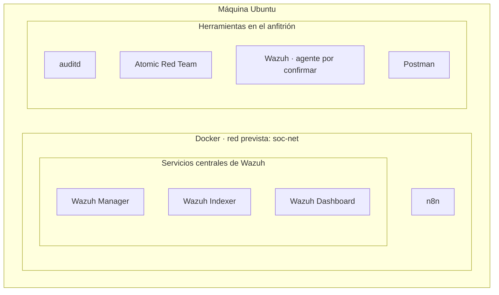

# N8n-Wazuh-SecurityAgent

Laboratorio de ciberseguridad en desarrollo sobre una única máquina Ubuntu, con Wazuh y n8n desplegados en Docker.

## Objetivo

Construir un agente de ciberseguridad autónomo. El proyecto documentará progresivamente el despliegue del laboratorio, las integraciones, las pruebas y los resultados.

Las capacidades de análisis, decisión y respuesta del agente, así como su grado de autonomía, están pendientes de definir e implementar.

## Origen de la idea

La idea de este proyecto está inspirada en el repositorio [Atlantium-AI/wazuh-n8n-lab-setup](https://github.com/Atlantium-AI/wazuh-n8n-lab-setup), que se reconoce como referencia de partida para este laboratorio.

## Estado actual

Estado documentado a partir de los avances comunicados por el autor el **17 de noviembre de 2026**.

| Componente | Ubicación prevista | Estado confirmado |
|---|---|---|
| Ubuntu | Máquina anfitriona del laboratorio | Entorno del proyecto |
| Docker | Ubuntu | Instalado |
| Wazuh | Docker | Instalado |
| n8n | Docker | Instalado |
| Red Docker `soc-net` | Docker | Incluida en el diseño; configuración pendiente de documentar |
| auditd | Ubuntu, fuera de Docker | Pendiente de instalar |
| Atomic Red Team | Ubuntu, fuera de Docker | Pendiente de instalar |
| Wazuh en el anfitrión | Ubuntu, fuera de Docker | Incluido en el diseño; función como agente e instalación pendientes de confirmar |
| Postman | Ubuntu, fuera de Docker | Incluido en el diseño; instalación pendiente de confirmar |

La instalación de Wazuh y n8n está confirmada por el autor. Las configuraciones, la conectividad y el funcionamiento conjunto se documentarán con evidencias conforme avance el proyecto.

## Arquitectura prevista

Todos los componentes se alojan en una única máquina Ubuntu. El diseño contempla los servicios centrales de Wazuh y n8n dentro de Docker, y las herramientas de auditoría y pruebas directamente en el anfitrión.

El siguiente diagrama representa la distribución prevista de los componentes. La pertenencia a la red `soc-net` deberá verificarse con la configuración del despliegue.

### Función prevista de los componentes

| Componente | Función en el diseño |
|---|---|
| Wazuh Manager | Procesamiento de eventos y generación de alertas |
| Wazuh Indexer | Indexación y almacenamiento de los datos de Wazuh |
| Wazuh Dashboard | Consulta y visualización de la información de seguridad |
| n8n | Orquestación de flujos de automatización e integraciones |
| auditd | Generación de registros de auditoría del sistema Ubuntu |
| Atomic Red Team | Ejecución de pruebas controladas para evaluar la detección |
| Agente Wazuh, pendiente de confirmar | Recogida y envío de eventos del anfitrión |
| Postman | Pruebas de peticiones e integraciones mediante API |

Estas funciones describen el diseño previsto. Las integraciones entre componentes todavía no están documentadas como operativas.

## Próximos pasos

- [x] Instalar Docker.
- [x] Desplegar Wazuh en Docker.
- [x] Desplegar n8n en Docker.
- [ ] Incorporar las versiones, los requisitos y los archivos reales de despliegue.
- [ ] Documentar y verificar la red `soc-net`.
- [ ] Confirmar la función e instalación del componente Wazuh del anfitrión.
- [ ] Instalar y configurar auditd.
- [ ] Instalar Atomic Red Team.
- [ ] Confirmar la instalación de Postman.
- [ ] Configurar y comprobar la recogida de eventos del anfitrión en Wazuh.
- [ ] Implementar y documentar la integración entre Wazuh y n8n.
- [ ] Definir e implementar las capacidades y los límites de autonomía del agente.
- [ ] Documentar una prueba completa con sus eventos, alertas y resultados.

## Documentación y evidencias

El repositorio incorporará los siguientes materiales a medida que estén disponibles:

- Archivos de despliegue y pasos para reproducir el entorno.
- Configuraciones de auditd y reglas personalizadas de Wazuh.
- Flujos de n8n exportados y código desarrollado para el agente.
- Pruebas realizadas, resultados esperados y resultados observados.
- Capturas y ejemplos de eventos y alertas.
- Decisiones técnicas, problemas resueltos y limitaciones.

**Todavía no se incluyen instrucciones reproducibles de instalación, flujos exportados ni resultados de pruebas.**

Los archivos publicados deberán usar valores de ejemplo en lugar de contraseñas, tokens, claves privadas o credenciales del laboratorio.

## Registro de avances

| Fecha | Avance |
|---|---|
| 2026-11-17 | Documentación inicial del objetivo, la arquitectura prevista y el estado comunicado: Docker, Wazuh y n8n instalados; auditd y Atomic Red Team pendientes. |
